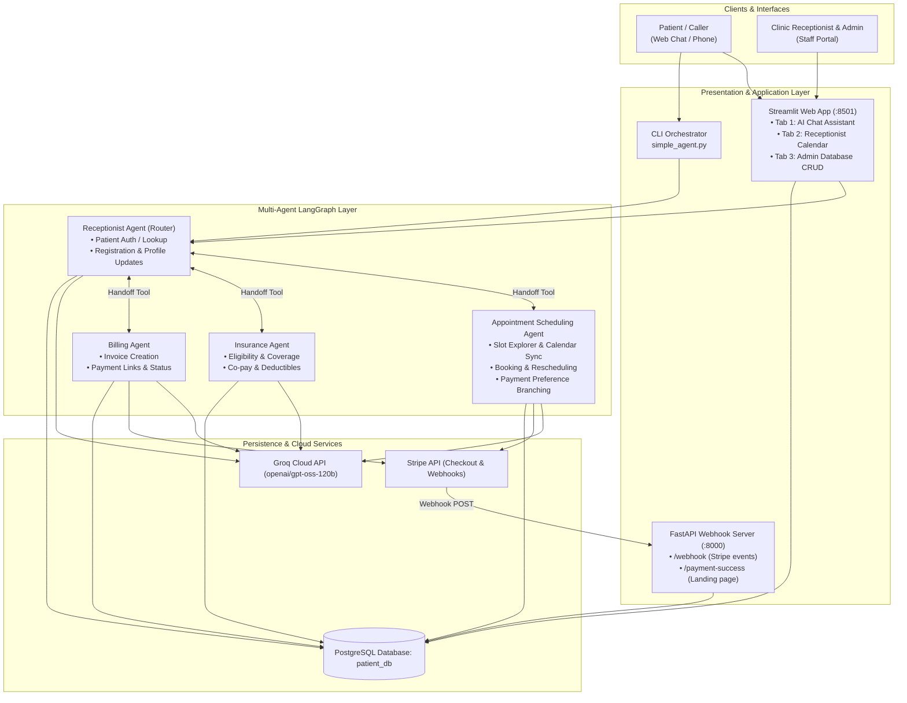
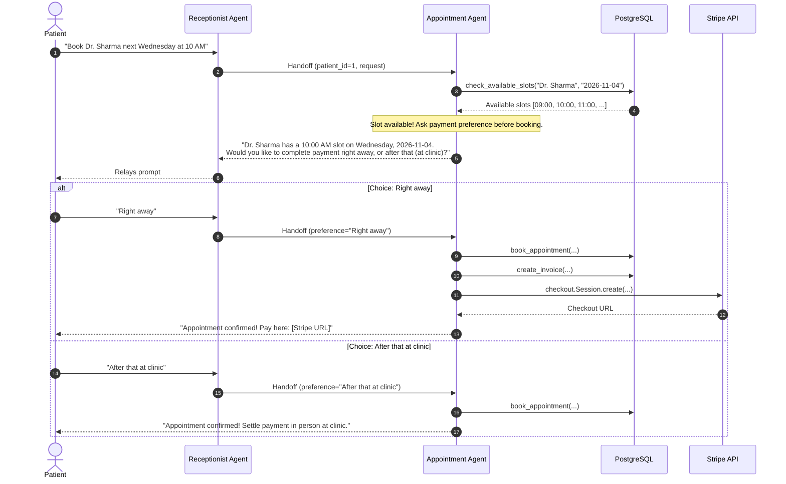

# 🩺 MediFlow AI — Inbound Medical Calling & Clinic Management Agent

An intelligent, multi-agent healthcare reception and practice management platform. MediFlow AI handles incoming patient interactions, validates patient records, explores doctor availability, books and reschedules appointments with dynamic calendar calculation, checks insurance eligibility, and automates billing through Stripe checkout sessions and asynchronous webhooks.

[](https://www.python.org/downloads/)
[](https://groq.com)
[](https://streamlit.io)
[](https://fastapi.tiangolo.com)
[](https://stripe.com)
[](https://www.postgresql.org)

---

## 🚀 Key Features

- **Multi-Agent Orchestration**: Specialized sub-agents (Receptionist Router, Appointment Scheduling, Insurance Eligibility, Billing) built with LangGraph & LangChain, powered by Groq's `openai/gpt-oss-120b`.
- **Payment-Preference Appointment Booking**:
  - Automatically queries available doctor slots.
  - Asks the patient for payment preference: **"Right away"** (generating an instant Stripe Checkout payment link) or **"After that at the clinic"** (in-person settlement).
  - Appointments are confirmed only after the preference is chosen.
- **Unified 3-Tab Streamlit Portal (`app.py`)**:
  - **Tab 1: AI Chat Assistant**: Full multi-turn conversational patient portal with real-time intent routing.
  - **Tab 2: Receptionist Calendar Board**: Visual appointment tracking by date/doctor, status indicators, and real-time open slot explorer.
  - **Tab 3: Admin Database Center**: Comprehensive CRUD operations across all 10 PostgreSQL tables, record search, and 1-click database synchronization.
- **Stripe Payment Engine & Webhook Server (`api.py`)**:
  - Asynchronous webhook processing for `checkout.session.completed`.
  - Idempotent event processing with cryptographic signature verification (`stripe-signature`).
  - Automatically updates invoice status to `paid` and records payments in the database.
- **Zero Hallucination Calendar Engine**:
  - Translates relative dates ("next Wednesday", "tomorrow", "next Monday") deterministically using Python date arithmetic.
- **Security & Data Privacy**:
  - Database internal keys (`patient_id`, `doctor_id`) are stripped from agent responses, presenting only patient-safe identifiers.

---

## 🏛️ System Architecture



---

## 🤖 Multi-Agent Breakdown

| Agent | Responsibilities | Key Tools |
| :--- | :--- | :--- |
| **Receptionist Agent** | First touchpoint, patient verification by mobile, registration, profile updates, synchronous delegation to specialists. | `check_patients_exist`, `insert_patient`, `update_patient_records`, `handoff_to_appointment_agent`, `handoff_to_insurance`, `handoff_to_billing` |
| **Appointment Agent** | Calendar date calculations, available slot lookup, booking, rescheduling, cancellations, **payment preference enforcement**. | `resolve_relative_date`, `list_doctors_and_specializations`, `check_available_slots`, `book_appointment`, `cancel_appointment`, `reschedule_appointment`, `create_invoice`, `generate_payment_link` |
| **Insurance Agent** | Verification of insurance policies, coverage rules, copay calculation, coinsurance, and deductibles. | `check_insurance_eligibility` |
| **Billing Agent** | Invoice generation, Stripe checkout URL creation, and live payment status tracking. | `create_invoice`, `generate_payment_link`, `check_invoice_payment_status` |

---

## 💳 Payment-Preference Booking Flow



---

## 📁 Repository Structure

```
.
├── .env                       # Environment variables (Keys, DB configuration, Model selection)
├── README.md                  # Project overview and documentation
├── SYSTEM_DESIGN_HLD_LLD.md   # Detailed High-Level & Low-Level Design specification
├── app.py                     # Streamlit 3-Tab Web Portal
├── api.py                     # FastAPI Stripe Webhook & confirmation server
├── simple_agent.py            # CLI entry point orchestrator (90 lines)
├── populate_db.py             # Database seeding and synchronization script
├── test_all_scenarios.py      # Automated multi-turn scenario test suite
├── requirements.txt           # Python dependencies
│
├── config/                    # Database connection and structured logging
│   ├── __init__.py
│   ├── db_config.py
│   └── logging_config.py
│
├── tools/                     # Modular tool execution package
│   ├── __init__.py
│   ├── patient_tools.py       # Patient lookup, insert, update
│   ├── date_utils.py          # Calendar calculation & relative date resolver
│   ├── appointment_tools.py   # Slot checking, booking, cancellation, reschedule
│   ├── insurance_tools.py     # Insurance eligibility & copay calculations
│   └── billing_tools.py       # Invoices, Stripe links, payment status
│
└── agents/                    # LangGraph multi-agent package
    ├── __init__.py
    ├── callbacks.py           # Structured latency and execution logger
    ├── receptionist.py        # Receptionist agent & handoff definitions
    ├── appointment.py         # Appointment agent with payment preference logic
    ├── insurance.py           # Insurance agent
    └── billing.py             # Billing agent
```

---

## 🛠️ Getting Started

### 1. Prerequisites
- Python 3.10+
- PostgreSQL 14+
- A [Groq API Key](https://console.groq.com)
- A [Stripe Account](https://stripe.com) (for testmode API keys)

### 2. Installation

```bash
# Clone the repository
git clone https://github.com/mihirnexus547/medical-calling-agent-inbound.git
cd medical-calling-agent-inbound

# Create and activate a virtual environment
python3 -m venv inbound_agent
source inbound_agent/bin/activate

# Install dependencies
pip install -r requirements.txt
```

### 3. Environment Configuration

Create a `.env` file in the root directory:

```ini
# Groq LLM Configuration
GROQ_API_KEY="your_groq_api_key"
GROQ_MODEL="openai/gpt-oss-120b"

# Stripe Payment Gateway
STRIPE_SECRET_KEY="sk_test_..."
STRIPE_WEBHOOK_SECRET="whsec_..."

# PostgreSQL Database Configuration
DB_NAME="patient_db"
DB_USER="postgres"
DB_PASSWORD="your_postgres_password"
DB_HOST="localhost"
DB_PORT="5432"

# Observability (Optional)
LANGSMITH_TRACING="true"
LANGSMITH_API_KEY="lsv2_..."
LANGSMITH_PROJECT="mca_multiagent_inbound"
```

### 4. Database Setup & Seeding

Ensure PostgreSQL is running, then initialize and populate the schema:

```bash
python3 populate_db.py
```
This populates:
- 15 Doctors across multiple specializations
- Realistic patient records with verified phone numbers
- Real-time availability slots for the next 21 days
- Service catalog prices (Consult, Follow-up, Specialist, Lab)
- Insurance plans (Gold, Silver, Bronze) with coverage rules and policies

---

## 🖥️ Running the Application

### 1. Start the FastAPI Webhook Server
```bash
uvicorn api:app --reload --port 8000
```
- Webhook endpoint: `POST http://localhost:8000/webhook`
- Payment success redirect: `http://localhost:8000/payment-success`

### 2. Start the Streamlit Web Portal
```bash
streamlit run app.py --server.port 8501
```
Open **[http://localhost:8501](http://localhost:8501)** in your browser:
- **Tab 1: AI Chat Assistant** (Chat directly with the medical agent)
- **Tab 2: Receptionist Calendar** (View bookings per day and available slots)
- **Tab 3: Admin Database Center** (Perform full CRUD operations on all tables)

### 3. (Optional) Run the CLI Interactive Mode
```bash
python3 simple_agent.py
```

---

## 🧪 Testing

Run automated end-to-end multi-turn scenarios:
```bash
python3 test_all_scenarios.py
```

### Sample Conversation:
```
User: Hi, my phone is 787020112351
Agent: Hello Aarav! Welcome back. How can I assist you today?

User: I want to book an appointment with Dr. Sharma next Wednesday at 10 AM
Agent: Dr. Sharma (Cardiologist) has an open slot at 10:00 AM on Wednesday, 2026-11-04.
       Before I book it, how would you like to handle payment?
       1. Right away – I'll book the appointment and send you a payment link now.
       2. After that (at clinic) – I'll book it and you can pay in person when you visit.

User: Right away
Agent: Your appointment is confirmed!
       - Doctor: Dr. Sharma (Cardiologist)
       - Date: Wednesday, 2026-11-04
       - Time: 10:00 AM
       - Appointment ID: 78
       Payment: You can complete the payment right away using the link below:
       https://checkout.stripe.com/c/pay/cs_test_...
       The amount due is $150.00.
```

---

## 📄 Documentation

For full architectural blueprints, database schema ER diagrams, and sequence diagrams, refer to [SYSTEM_DESIGN_HLD_LLD.md](SYSTEM_DESIGN_HLD_LLD.md).

---

## 🛡️ License

This project is licensed under the MIT License.