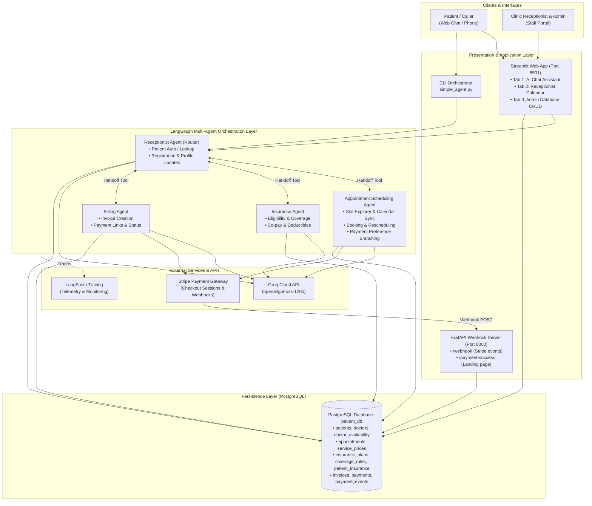
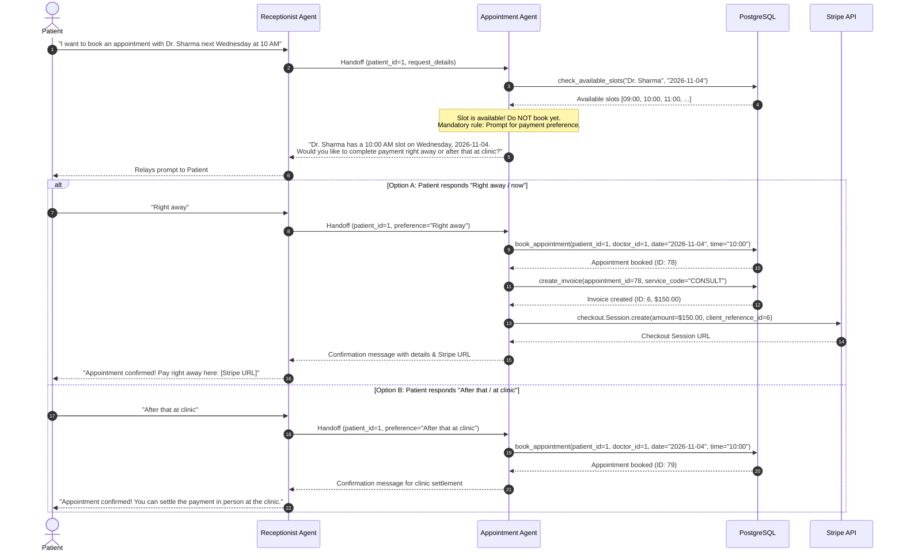
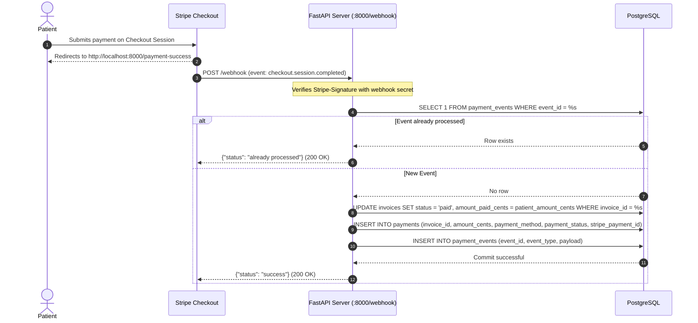
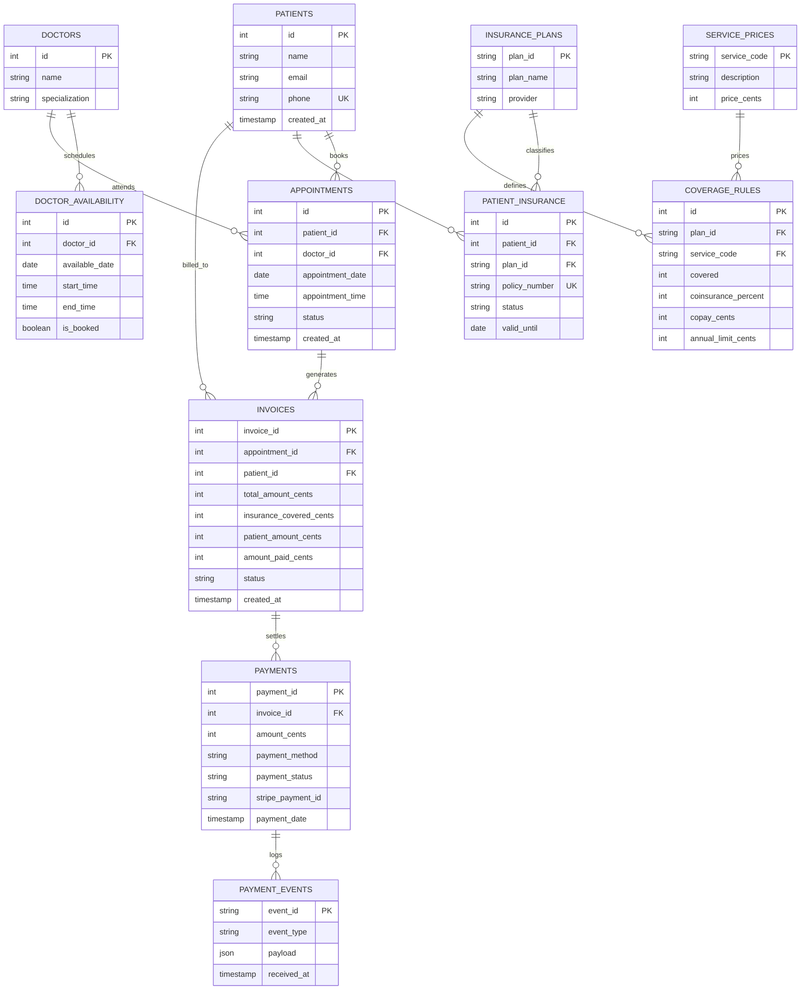

# MediFlow AI: Inbound Medical Calling & Appointment System
## Comprehensive High-Level Design (HLD), Low-Level Design (LLD), and System Architecture

---

## 1. Executive Summary

**MediFlow AI** is an intelligent, multi-agent inbound healthcare receptionist and clinic management platform. It automates patient verification, doctor lookup, appointment booking with real-time calendar synchronization, insurance coverage verification, and automated billing via Stripe. 

The system features:
1. **Multi-Agent Orchestration**: Specialized sub-agents (Receptionist, Appointment, Insurance, Billing) powered by Groq's `openai/gpt-oss-120b` LLM.
2. **Conditional Payment-Preference Flow**: Before an appointment is booked, patients are asked whether they wish to pay **right away** (generating a Stripe Checkout link) or **after that at the clinic** (settling in person). Booking is finalized only after this preference is selected.
3. **Unified Streamlit Web Portal**:
   - **Tab 1: AI Chat Assistant**: Full conversational multi-agent interface for patients.
   - **Tab 2: Receptionist Calendar Board**: Interactive visual appointment board, doctor filters, status badges, and open slot explorer.
   - **Tab 3: Admin Database Center**: Complete CRUD operations across all PostgreSQL tables.
4. **Stripe Payment Engine & Webhook Reconciliation**: Asynchronous payment lifecycle tracking with idempotent webhook handling via FastAPI.

---

## 2. High-Level Design (HLD)

### 2.1 System Architecture Diagram



---

### 2.2 Core Architectural Principles

1. **Separation of Concerns via Specialized Agents**:
   - Instead of a single 2,000-line prompt with dozens of tools, agents are decomposed into focused units: Receptionist, Appointment, Insurance, and Billing.
2. **Deterministic Tool Execution**:
   - Critical operations (calendar dates, slot checking, booking, database queries, Stripe API calls) are performed strictly via Python tools rather than LLM memory or calculation.
3. **Synchronous Handoff Protocol**:
   - The primary router (Receptionist Agent) delegates domain tasks via synchronous handoff tools. The sub-agent's response is returned directly to the user without intermediate conversational loss.
4. **Idempotent Billing & Payment Reconciliation**:
   - Webhooks verify Stripe cryptographic signatures (`stripe-signature`), deduplicate events against `payment_events`, and update database status atomically.
5. **Data Protection & PII Isolation**:
   - Internal database IDs (e.g. `patient_id`, `doctor_id`) are stripped from agent responses, presenting only human-readable doctor names, dates, times, and reference codes.

---

## 3. Multi-Agent System & How It Works

### 3.1 Agent Matrix & Responsibilities

| Agent Name | Scope & Responsibilities | Tools Used | State / Checkpointer |
| :--- | :--- | :--- | :--- |
| **Receptionist Agent** (Router) | Patient verification by phone, registration, updating records, top-level intent routing | `check_patients_exist`, `insert_patient`, `update_patient_records`, `handoff_to_appointment_agent`, `handoff_to_insurance`, `handoff_to_billing` | `PostgresSaver` (thread: `thread_{patient_id}_{uuid}` in PostgreSQL `patient_db`) |
| **Appointment Agent** | Slot availability, calendar date math, booking, rescheduling, cancellations, **fee quotation & confirmation** | `resolve_relative_date`, `list_doctors_and_specializations`, `check_available_slots`, `book_appointment`, `get_patient_appointments`, `cancel_appointment`, `reschedule_appointment`, `create_invoice`, `generate_payment_link`, `check_consultation_fee` | `PostgresSaver` (thread: `appt_patient_{id}`) |
| **Insurance Agent** | Verification of patient insurance policy, service coverage percentage, copay amount, deductible status | `check_insurance_eligibility` | `PostgresSaver` |
| **Billing Agent** | Invoice generation, payment link dispatch, real-time payment status checks | `create_invoice`, `generate_payment_link`, `check_invoice_payment_status` | `PostgresSaver` |

---

### 3.2 The Appointment & Payment-Preference Workflow

To ensure clinics do not suffer from no-shows or uncollected revenue, the system enforces a strict business rule:



---

### 3.3 Asynchronous Payment Reconciliation (Webhook Lifecycle)

When the patient completes checkout using the Stripe URL, the webhook handles fulfillment:



---

## 4. Low-Level Design (LLD)

### 4.1 Directory & Package Structure

```
/home/nls58/mihir/mca_inbound_agent/
├── .env                       # Environment variables (Groq model, keys, Stripe credentials, DB)
├── simple_agent.py            # CLI entry point orchestrator (90 lines)
├── app.py                     # Streamlit Unified Portal (Tabs 1, 2, and 3)
├── api.py                     # FastAPI Stripe Webhook & Payment Confirmation server
├── populate_db.py             # Database seed & test data synchronization script
│
├── config/                    # Core configuration package
│   ├── __init__.py            # Exports DB connection and logger
│   ├── db_config.py           # psycopg2 connection and cursor manager
│   └── logging_config.py      # Structured file and console logging formatter
│
├── tools/                     # Modular tool execution package
│   ├── __init__.py            # Tool exports
│   ├── patient_tools.py       # check_patients_exist, insert_patient, update_patient_records
│   ├── date_utils.py          # resolve_relative_date, get_calendar_context, resolve_date_helper
│   ├── appointment_tools.py   # list_doctors, check_available_slots, book_appointment, reschedule, cancel
│   ├── insurance_tools.py     # check_insurance_eligibility
│   └── billing_tools.py       # create_invoice, generate_payment_link, check_invoice_payment_status
│
└── agents/                    # Multi-agent LangGraph package
    ├── __init__.py            # Agent exports & thread definitions
    ├── callbacks.py           # AgentLoggingCallback (tracks tool calls & LLM latencies)
    ├── receptionist.py        # Receptionist Agent & synchronous handoff tool wrappers
    ├── appointment.py         # Appointment Scheduling Agent with payment preference logic
    ├── insurance.py           # Insurance Verification Agent
    └── billing.py             # Billing Agent
```

---

### 4.2 Database Schema & ER Model



---

### 4.3 Detailed Tool Specifications & Contracts

#### 1. `check_patients_exist(phone_number: str) -> dict`
- **Purpose**: Authenticates or searches a patient by phone number.
- **SQL**: `SELECT id, name, email, phone FROM patients WHERE phone = %s`
- **Returns**: `{"exists": True, "patient_id": 1, "name": "Aarav Patel", "email": "aarav@example.com"}` or `{"exists": False}`.

#### 2. `resolve_relative_date(expression: str) -> str`
- **Purpose**: Eliminates LLM date calculation errors.
- **Implementation**: Uses Python `date.today()`, `relativedelta`, and calendar week math to translate phrases like "next Wednesday", "tomorrow", or "day after tomorrow" into exact `YYYY-MM-DD` and weekday names.

#### 3. `check_available_slots(doctor_name: str, available_date: str) -> str`
- **Purpose**: Queries real-time unbooked slots from `doctor_availability` and joins with active `appointments`.
- **Constraint**: Excludes slots where `is_booked = true` or where an appointment is already booked and not cancelled.

#### 4. `book_appointment(patient_id: int, doctor_id: int, appointment_date: str, appointment_time: str) -> str`
- **Purpose**: Atomic insertion into `appointments` and updates `doctor_availability.is_booked = true`.
- **Pre-condition**: Slot must be verified. Payment preference must have already been confirmed by the patient.

#### 5. `create_invoice(patient_id: int, appointment_id: int, service_code: str) -> str`
- **Purpose**: Computes service cost from `service_prices`, checks `patient_insurance` and `coverage_rules`, calculates insurance deductible/copay, and creates an `invoices` record with status `'pending'`.

#### 6. `generate_payment_link(invoice_id: int, delivery_channel: str = "sms") -> str`
- **Purpose**: Generates a live Stripe Checkout Session.
- **Stripe Parameters**:
  - `mode="payment"`
  - `client_reference_id=str(invoice_id)`
  - `success_url="http://localhost:8000/payment-success?session_id={CHECKOUT_SESSION_ID}"`
  - `line_items=[{"price_data": {...}, "quantity": 1}]`
- **Returns**: Clickable checkout URL.

#### 7. `check_invoice_payment_status(invoice_id: int) -> str`
- **Purpose**: Looks up `invoices` and `payments` to report real-time status (`paid`, `pending`, `cancelled`).

---

### 4.4 Streamlit Front-End Architecture (`app.py`)

The application is structured into three distinct views:

1. **Tab 1: AI Chat Assistant**:
   - Maintains chat message history in `st.session_state.chat_history`.
   - Passes messages directly to `receptionist_agent` with full conversation continuity.
   - Live metrics (Total queries, Active Patient, Current Time).
2. **Tab 2: Receptionist Calendar & Appointment Board**:
   - Filter by date and doctor.
   - Color-coded status badges (`confirmed`, `pending`, `cancelled`).
   - Open Slot Explorer: Shows all available time slots per doctor for any selected calendar date.
   - Quick action to cancel or reschedule appointments directly from the UI.
3. **Tab 3: Admin Database Center**:
   - Full CRUD tables: Patients, Doctors, Doctor Availability, Appointments, Invoices, Payments, Insurance Policies, Coverage Rules.
   - Search and filter records.
   - Add new records with form validation.
   - Delete records with confirmation guardrails.
   - Instant Database Synchronization button to re-run `populate_db.py`.

---

## 5. Non-Functional Requirements & Operational Robustness

### 5.1 Rate Limiting & Resilience
- **LLM Engine**: Groq API (`openai/gpt-oss-120b`).
- **429 Handling**: LangChain Groq client includes automatic exponential backoff.
- **Connection Health**: FastAPI and Streamlit initialize connections per transaction or query to avoid stale socket timeouts.

### 5.2 Security & Data Protection
1. **Webhook Integrity**: `api.py` enforces HMAC-SHA256 signature verification using Stripe Webhook Secret (`whsec_...`).
2. **Idempotency**: All Stripe webhook events are recorded in `payment_events(event_id)`. Re-delivered events return `status: already processed` immediately.
3. **Database ID Masking**: Prompts forbid exposing raw `patient_id` or `doctor_id` to end users.
4. **Environment Isolation**: All credentials (`GROQ_API_KEY`, `STRIPE_SECRET_KEY`, `DB_PASSWORD`) are loaded strictly from `.env`.

---

## 6. How to Run & Verify the System

### 6.1 Prerequisites
- PostgreSQL running on `localhost:5432` with database `patient_db`.
- Python 3.10+ virtual environment (`inbound_agent`).

### 6.2 Service Commands

| Component | Command | Endpoint / Access |
| :--- | :--- | :--- |
| **Streamlit Web Portal** | `streamlit run app.py --server.port 8501` | [http://localhost:8501](http://localhost:8501) |
| **Stripe Webhook Server** | `uvicorn api:app --reload --port 8000` | [http://localhost:8000](http://localhost:8000) |
| **Console Interactive CLI** | `python3 simple_agent.py` | Terminal interactive mode |
| **Database Reset & Seed** | `python3 populate_db.py` | Standalone execution |
